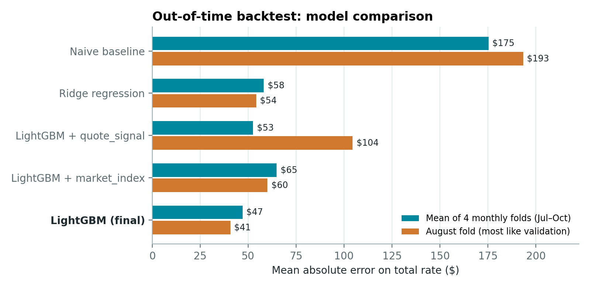
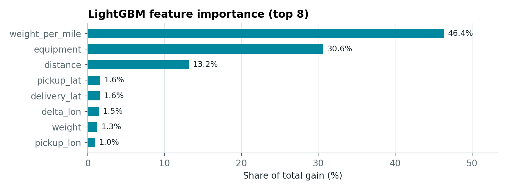

# Freight Rate Prediction

Predicting the posted rate (in $) for truckload freight loads from historical load data.
The final model is a **LightGBM** regressor that predicts **rate per mile** and multiplies by distance.

On an out-of-time backtest over four held-out months (July–October 2025) it reaches
**MAE $47.08 / MAPE 1.99%**, and **$40.74 on August** — the month whose feature behaviour matches the
November–December prediction window. A naive baseline scores $175 and Ridge regression $58.

Full write-up: [`reports/Freight_Rate_Report.pdf`](reports/Freight_Rate_Report.pdf)

## Results

| Model | Jul | Aug | Sep | Oct | Mean MAE | Mean MAPE |
|---|---|---|---|---|---|---|
| Naive: equipment median $/mile × distance | $156.74 | $193.42 | $177.84 | $172.98 | $175.25 | 8.04% |
| Ridge regression | $70.71 | $54.18 | $56.80 | $50.89 | $58.14 | 2.75% |
| LightGBM + quote_signal | $44.01 | $104.48 | $28.27 | $33.46 | $52.55 | 2.32% |
| LightGBM + market_index | $41.69 | $60.09 | $89.58 | $68.29 | $64.91 | 2.97% |
| **LightGBM (final)** | **$64.27** | **$40.74** | **$43.92** | **$39.40** | **$47.08** | **1.99%** |



## Approach

### Validation design

Training data covers January–October; the prediction targets are November–December. Validation is
therefore **out-of-time with an expanding window**: train on all months before July, August, September
and October in turn, and test on that month. Random K-fold would leak future information into
training and — critically — would have hidden the `quote_signal` problem below.

### The leaking feature

`quote_signal` is the single strongest predictor by correlation and the worst feature in the set.

- It **equals** the true rate per mile in Jan/Feb/Mar/Jun/Sep (corr **+0.996**)
- It **mirrors** it in Apr/May/Jul/Oct (corr **−0.99**)
- It is **noise** in August

The unlabelled target months carry August's signature, not the leak's: `quote_signal` correlates ~0
with distance there, versus ±0.7 in every other month. Including it produces $28–$33 MAE in the leak
months and **$104 on August — 2.6× worse than the final model**. It scores better on average and
would fail on the period that actually matters, so it is excluded.

`market_index` is also excluded: it swings from 0.89 to 1.30 across the year while rate per mile
barely moves, and it is worse on average. Smoothed variants did not help.

### Data quality

- **Label errors:** 677 training rows (1.4%) sit far from the normal rate per mile, in two clusters at
  roughly 0.3× and 3.5×. Rows outside $1.30–$4.00 per mile are dropped from training.
- **Negative weights** (292 train, 145 validation): the range is symmetric at ±47,500, so these are
  sign errors. Absolute value corrects them, with a flag column recording the change.
- **Missing values:** weight filled with the training median, market_index with that day's mean, each
  with a missing-value indicator.
- **Unseen cities:** 8 validation cities never appear in training, so the model keys on lat/lon rather
  than city names and handles new locations.

### Model

LightGBM on rate per mile with **Huber loss** (robust to residual label noise), weighted by distance so
the loss tracks dollar error rather than per-mile error. Refit on all January–October data using the
averaged early-stopping round count.



## Running it

Requires Python 3.11+.

```bash
python -m venv venv
source venv/bin/activate          # Windows: venv\Scripts\activate
python -m pip install -r requirements.txt

python src/eda.py                 # data audit + charts in reports/figures/
python src/train.py               # backtest, model comparison, saves models/freight_model.pkl
python src/predict.py             # writes predictions
python src/report_figures.py      # rebuilds report charts
python -m pytest -q               # sanity tests for cleaning and output format
```

The pipeline is deterministic (`random_state=42`) and runs end to end in under a minute.

> **Note:** the source datasets are not included in this repository. The code, metrics, figures and
> report are provided so the method and results can be reviewed.

## Structure

```
├── src/
│   ├── eda.py             # data-quality audit, target analysis, drift checks, figures
│   ├── preprocess.py      # loading, cleaning, feature engineering (shared by train and predict)
│   ├── train.py           # out-of-time backtest, baselines, ablation, final refit
│   ├── predict.py         # inference and prediction files
│   └── report_figures.py  # charts used in the written report
├── reports/
│   ├── figures/           # EDA and report charts
│   ├── metrics.json       # backtest metrics and feature importance
│   └── Freight_Rate_Report.pdf
├── tests/                 # pytest sanity tests
└── requirements.txt
```